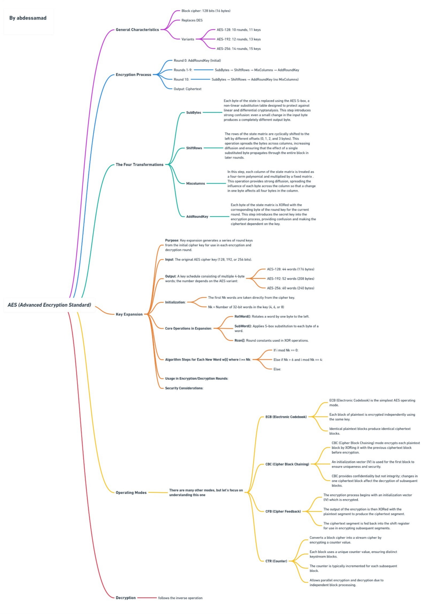
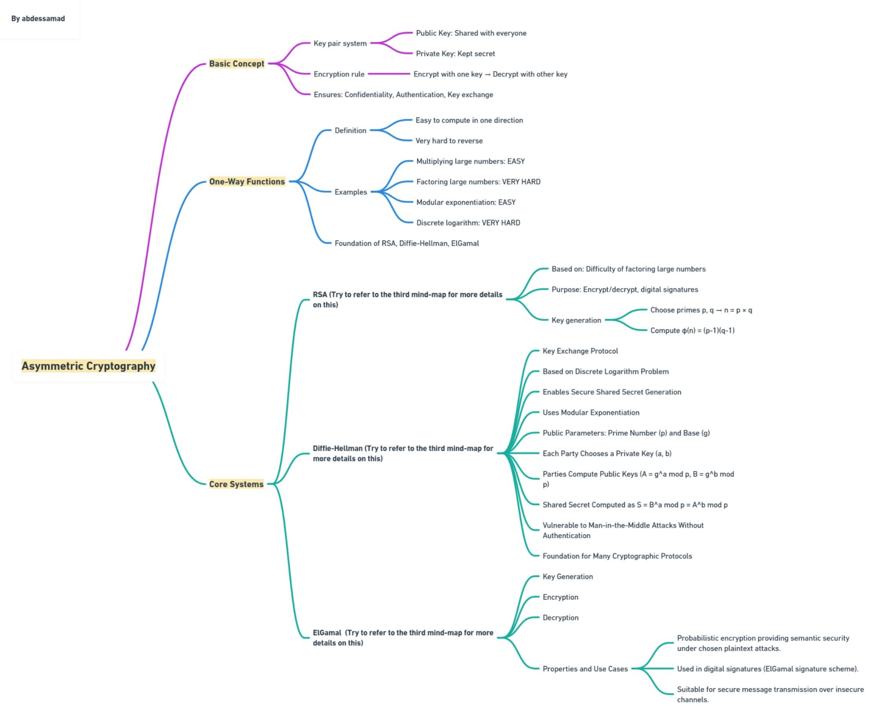

# Cryptography Analysis: Symmetric vs Asymmetric Systems

[](#overview)
[](#contents)
[](#mind-maps)
[](#asymmetric-systems-at-a-glance)
[](#resources)
[](#author)

## Overview

A study of the fundamentals of cryptography: the **AES** symmetric cipher and the main asymmetric systems (**RSA**, **Diffie-Hellman**, **ElGamal**), summarised in a written report and a set of mind maps.

- **Report:** [docs/cryptography_analysis_report.pdf](docs/cryptography_analysis_report.pdf)
- **Course:** Security M232 & Cryptography
- **Professor:** Prof. A. Harchaoui
- **Date:** December 2025

## Contents

| Part | Topics |
|---|---|
| **Symmetric cryptography** | AES architecture, encryption and decryption rounds, the four transformations (SubBytes, ShiftRows, MixColumns, AddRoundKey), key expansion, operating modes (ECB, CBC, CFB, CTR) |
| **Asymmetric cryptography** | Public/private keys, one-way functions, RSA, Diffie-Hellman, ElGamal, roles (encryption, signatures, key exchange), real-world uses (SSH, TLS/SSL, VPNs) |

### AES variants

| Variant | Rounds | Round keys |
|---|---|---|
| AES-128 | 10 | 11 |
| AES-192 | 12 | 13 |
| AES-256 | 14 | 15 |

All variants process 128-bit (16-byte) blocks.

## Mind maps

**AES**



**Asymmetric cryptography**



The detailed mind maps for RSA, Diffie-Hellman, ElGamal and their comparison, with step-by-step numerical examples, are in [mind-maps/major_asymmetric_systems_mind_maps.pdf](mind-maps/major_asymmetric_systems_mind_maps.pdf).

## Asymmetric systems at a glance

| | RSA | Diffie-Hellman | ElGamal |
|---|---|---|---|
| **Purpose** | Encryption and signatures | Key exchange only | Encryption (signature variant exists) |
| **Hard problem** | Integer factorization | Discrete logarithm | Discrete logarithm |
| **Performance** | Slow | Medium | Slowest (two exponentiations) |

Common points: recommended key size of 2048 bits or more, vulnerable to quantum computers, and all are much slower than AES. In practice they are combined with AES (hybrid encryption).

## Resources

- [AES explained](https://youtu.be/3MPkc-PFSRI)
- [RSA and ElGamal cryptography](https://youtu.be/DjsaVpE_kdw)
- [Diffie-Hellman key exchange](https://youtu.be/d1KXDGgwIpA)
- [One-way functions](https://youtu.be/GE3dsA5S7M8)

## Repository structure

```
cryptography-symmetric-asymmetric-analysis/
├── docs/
│   └── cryptography_analysis_report.pdf
├── mind-maps/
│   ├── aes_mind_map.jpeg
│   ├── asymmetric_cryptography_mind_map.jpeg
│   ├── major_asymmetric_systems_mind_map.jpeg
│   └── major_asymmetric_systems_mind_maps.pdf
└── README.md
```

## Author

Abdessamad Ait Brahim, [@abdessamadaitbrahim](https://github.com/abdessamadaitbrahim)
